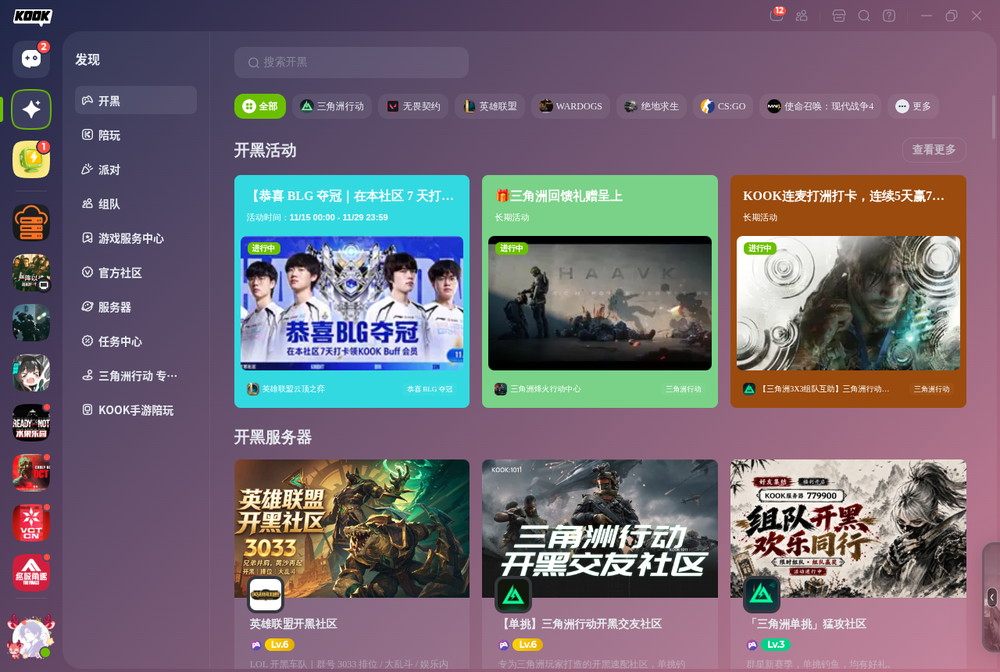

<div align="center">

# KOOK Linux

**KOOK 官方 Windows 客户端的 Linux 原生移植版**

直接运行官方客户端本体，把 Windows 专属的那一层在 Linux 上重新实现一遍——不是网页套壳。

[](https://github.com/kanniganfan/kook-linux/releases)
[](https://github.com/kanniganfan/kook-linux/releases)
[](LICENSE)
[]()
[]()
[](https://github.com/kanniganfan/kook-linux/stargazers)

[下载](#安装) · [功能](#功能) · [技术实现](#技术实现) · [常见问题](#常见问题) · [从源码构建](#从源码构建)

</div>

---

<div align="center">

<br>
<sub>发现页 · GNOME / Wayland 会话</sub>
</div>

---

## 简介

KOOK（原开黑啦）的 PC 客户端从发布至今只有 Windows 和 macOS 版本，**官方没有发布过
Linux 客户端，也没有公开的 Linux 发布计划**。Linux 用户只能拿 Wine / Proton 跑 Windows
版，语音链路、屏幕分享、快捷键、托盘基本全是残的。

这个项目换了个做法：把官方客户端拆开，**原封不动地运行它自己的 `app.asar`**
（原版 webapp、原版 preload、原版业务逻辑），只把 Windows 专属的那一层——原生模块、
进程枚举、屏幕采集、托盘、全局快捷键、窗口行为——在 Linux 上重新实现一遍。

所以它不是一个"仿 KOOK 的客户端"，也不是把网页塞进 Electron 的壳：
**协议、接口、界面全部来自官方本体**，209 个 IPC 通道逐个真实现，没有任何空壳占位。

| | |
|---|---|
| **版本** | 跟随最新 [Release](https://github.com/kanniganfan/kook-linux/releases) |
| **移植基线** | 官方 PC 客户端 `0.112.0`（构建 `c5af713-kook_3321`） |
| **运行时** | Electron 36.7.4 / Chromium 136 |
| **支持架构** | x86_64 |
| **许可** | MIT（仅移植层） |
| **移植与适配** | KANNI（KOOK 昵称 KANNI#0001）· <cylqm@qq.com> |

> 本项目与 KOOK 官方无关，是社区移植作品。官方客户端及其资源的所有权利归其所有者。

---

## 目录

- [简介](#简介)
- [功能](#功能)
- [技术实现](#技术实现)
- [安装](#安装)
- [兼容性](#兼容性)
- [常见问题](#常见问题)
- [从源码构建](#从源码构建)
- [项目结构](#项目结构)
- [已知限制](#已知限制)
- [更新节奏](#更新节奏)
- [反馈](#反馈)
- [致谢](#致谢)
- [许可](#许可)

---

## 功能

### 客户端本身

| 功能 | 状态 | 说明 |
|---|:---:|---|
| 登录 / 账号 | ✅ | 走官方接口，补齐 Linux 设备指纹与 Windows 环境标识 |
| 文字聊天 / 频道 / 服务器 | ✅ | 官方业务逻辑，不改协议 |
| 语音频道 | ✅ | 官方 RTC 链路（Chromium WebRTC，不依赖原生 SDK） |
| 屏幕分享 | ✅ | `xdg-desktop-portal` + PipeWire 采集，面板内实时预览持续刷新 |
| 屏幕覆盖 | ⚠️ | X11 全局置顶；Wayland 限制在 KOOK 窗口内 |
| 录制 / 分享流管理 | ✅ | 分享会话、录制状态、停止通知全部接上 |
| 用户动态（游戏识别） | ✅ | 官方进程活动引擎 + Linux `/proc`，内置官方 2000 条进程名活动库 |
| 桌面通知 | ✅ | `libnotify`；无通知服务的极简桌面降级为任务栏闪烁 + 标题前缀 |
| 图片查看器 | ✅ | 官方图片查看器重做，支持缩放、拖拽、保存 |
| 应用内子窗口 | ✅ | 设置、关于、更新记录等弹窗按无边框窗口规则生成 |

### Linux 适配层

| 功能 | 状态 | 说明 |
|---|:---:|---|
| 全局快捷键 | ✅ | `globalShortcut` + 本地键盘桥双通道，Wayland 下按键说话可用 |
| 悬浮工具栏 | ✅ | 无边框、透明、置顶、跨工作区、可拖动的独立窗口 |
| 客户端透明 | ✅ | 真正透出桌面；个人设置保持不透明实底 |
| 叠加色透明 / 菜单毛玻璃 | ✅ | 与客户端透明相互独立，各自生效 |
| 无边框窗口 | ✅ | 自绘标题栏，拖动 / 双击最大化 / 边缘缩放全部接管 |
| 托盘常驻 | ✅ | StatusNotifier 规范，左键唤起、右键菜单 |
| 关闭到托盘 / 启动最小化 | ✅ | 设置面板可开关 |
| 开机自启 | ✅ | XDG autostart，不依赖 systemd |
| 硬件加速 / 效能模式 | ✅ | 渲染前读配置决定，效能模式走 POSIX nice |
| URL scheme | ✅ | 注册 `x-scheme-handler/kook`，网页唤起客户端 |
| 多语言界面 | ✅ | 简体中文 / 繁体中文 / 日文 / 英文 |
| 默认菜单栏移除 | ✅ | Linux 上那条 File/Edit/View 不出现 |
| 凭据安全存储 | ✅ | `safeStorage` 真后端 → `secret-tool` + AES-256-GCM → 拒绝落盘，三层递降 |
| 自动更新 | ❌ | **主动屏蔽**——官方更新器会装 Windows 安装包，覆盖掉移植版 |

---

## 技术实现

官方客户端跑得起来，靠的是把下面这些 Windows 专属能力逐个替换成 Linux 实现。
这部分是仓库里 `patches/` 的全部内容。

### IPC 层

原版 preload 定义 **209 个 IPC 通道**，主进程侧必须全部应答，否则界面会在某个操作上卡死。
移植层按契约逐个实现，其中窗口控制占了 26 个（invoke / send 双通道），
最终挂载 **177 个真实通道**，其余是有意为之的空实现（Windows 注册表、系统代理之类）。

### 资源加载

官方 webapp 通过 `https://www.kookapp.cn/app/*` 这个同源加载。移植层不改这个约定，
而是在主进程里做**同源拦截**：把 `/app/*` 的请求直接指向磁盘上的本地 webapp，
再起一个本地 HTTP 服务兜底。偏离这个同源会让 API 全部返回 403「越权访问」，
所以这里必须和官方保持一致。

### 登录风控

服务端会校验客户端环境。移植层伪装 Windows 平台标识与 UA，并补齐设备指纹，
让登录走官方正常流程，而不是绕过风控。

### 进程枚举（用户动态）

官方的「正在玩什么」依赖 Windows 进程 API。移植层用 Linux `/proc` 重新实现，
并接上官方自带的活动库（约 2000 条进程名 → 游戏名映射），
所以识别结果和官方 Windows 版一致。

### 屏幕分享

Windows 用 DXGI 抓屏，Linux 换成 **xdg-desktop-portal + PipeWire**：

- 只在你点「分享屏幕」时申请一次系统授权，停止分享立即释放（杀 portal 会话、删 restore token）
- 每次投屏重新申请，不静默复用旧授权
- 一条 gst 流同时喂「面板内 MJPEG 实时预览」和「实际分享画面」，预览不会静止
- 能力缺失时降级并提示，不硬失败

### 屏幕覆盖

原版依赖 Windows 原生 overlay 层，Linux 上没有。移植层自己做一个真窗口：
透明、无边框、置顶、鼠标穿透，内容是「谁在说话」。Wayland 协议不允许普通应用
绘制全局置顶层，所以这种情况下改为在 KOOK 窗口内显示，并在设置面板里说明原因。

### 快捷键

`globalShortcut` 在 Wayland 下走 XGrabKey，只能抓到 X11 客户端。移植层额外加了一条
**本地键盘桥**：preload 把 `keydown/keyup` 按官方 `IO_HOOK` 的形状转发给主进程，
再派发成官方事件，同键码 120ms 去重。所以 KOOK 有焦点时 Wayland 下也能按键说话。

### 环境自检

启动时探测 `python` / `dbus` / `gstreamer` / `xprop` / `ffmpeg` 是否可用，
缺哪个就在对应功能上降级，不影响其它部分。不写死任何发行版路径，全部走 XDG 规范。

---

## 安装

去 [Releases](https://github.com/kanniganfan/kook-linux/releases/latest) 下载对应格式的包。

### AppImage（任何发行版）

```bash
chmod +x KOOK-*-x86_64.AppImage
./KOOK-*-x86_64.AppImage
```

免安装。启动器会自动适配会话环境（Wayland / X11、GTK 版本、sandbox），不需要手动加参数。

### Debian / Ubuntu / Deepin / UOS

```bash
sudo dpkg -i kook_*_amd64.deb
sudo apt -f install   # 补依赖
```

### Fedora / RHEL / openSUSE

```bash
sudo rpm -i kook-linux-*.x86_64.rpm
```

### 包的大小

三个包都在 160–230 MB。客户端本体约 104 MB，Electron 运行时约 466 MB（含官方
`modules/`），压缩后就是这个量级——这是完整运行官方本体的代价，不是打包失误。

---

## 兼容性

| 项目 | 支持情况 |
|---|---|
| 架构 | x86_64 |
| 发行版 | 任何 glibc 发行版（Arch / Debian / Fedora / openSUSE 实测） |
| 桌面环境 | GNOME / KDE Plasma / XFCE / Cinnamon / MATE |
| 会话 | X11、Wayland 都可用 |
| 语音 | PipeWire / PulseAudio |
| 屏幕分享 | `xdg-desktop-portal` + 对应桌面的后端 |

> 不写死任何路径，全部走 XDG 规范；依赖缺失时会降级并给出提示，不会直接崩溃。

---

## 常见问题

<details>
<summary><b>双击 AppImage 没有任何反应</b></summary>

先确认有执行权限：`chmod +x KOOK-*.AppImage`。

仍无反应的话，从终端运行一次看报错：

```bash
./KOOK-*-x86_64.AppImage
```

早期版本在 GNOME 下会因为 GTK3/GTK4 符号冲突直接退出（连日志都不留），现已修复：
启动器固定 `--gtk-version=3`。如果用的是旧包，请更新到最新 Release。
</details>

<details>
<summary><b>窗口能打开，但里面一片空白</b></summary>

这是早期打包漏了运行依赖导致的，0.0.11 起已修复。确认你下载的是最新版本。
</details>

<details>
<summary><b>Wayland 下「在桌面上显示」「全屏游戏时显示」不可用</b></summary>

Wayland 协议不允许普通应用绘制全局置顶层，这两项只在 X11 会话生效。设置面板里会自动
置灰并给出原因，不会假装成功。需要全局覆盖层可以登录 X11 会话。
</details>

<details>
<summary><b>快捷键不生效</b></summary>

Wayland 下全局抓键受限。KOOK 窗口有焦点时由本地键盘桥接管，无焦点时可能收不到。
X11 会话下全局快捷键正常。
</details>

<details>
<summary><b>用户动态里认不出我玩的游戏</b></summary>

识别靠官方活动库的 2000 条进程名映射。如果游戏不在库里，官方 Windows 版同样认不出。
可以提 Issue 附上进程名。
</details>

<details>
<summary><b>提示更新、要求下载安装包</b></summary>

自动更新已被主动屏蔽。官方更新器分发的是 Windows 安装包，装上去会覆盖移植版，所以更新
提示被改写成移植线的更新记录。需要新版请直接来 Releases 下载。
</details>

<details>
<summary><b>想反馈问题，需要提供什么</b></summary>

- 发行版与版本（`cat /etc/os-release`）
- 桌面环境与会话类型（`echo $XDG_CURRENT_DESKTOP $XDG_SESSION_TYPE`）
- KOOK 版本号
- `~/.config/KOOK/logs/` 下对应的日志片段
</details>

---

## 从源码构建

### 前置

- Node.js ≥ 18、npm
- 本机已安装官方 KOOK 客户端，并解包出 app 目录（默认 `~/kook-port/linux/app`）
- Electron 36.7.4 运行时目录（默认 `~/kook-port/e36/node_modules/electron/dist`）

路径可用环境变量覆盖：`KOOK_BASE_APP`、`electronDist`（在 `package.json` 里）。

### 出包

```bash
npm install                     # 只装打包工具 electron-builder
bash scripts/stage.sh           # 组装 .stage/app（官方基础文件 + 移植层补丁）
bash scripts/build.sh           # 三种包全打
bash scripts/build.sh AppImage  # 只打指定格式
bash scripts/build-rpm.sh       # 单独出 rpm（绕开 fpm）
```

产物在 `dist/`：

| 格式 | 文件名 | 适用 |
|---|---|---|
| AppImage | `KOOK-<ver>-x86_64.AppImage` | 任何发行版，免安装 |
| deb | `kook_<ver>_amd64.deb` | Debian / Ubuntu / Deepin / UOS |
| rpm | `kook-linux-<ver>.x86_64.rpm` | Fedora / RHEL / openSUSE |

详细步骤、依赖和踩坑记录见 [docs/BUILD.md](docs/BUILD.md)。

---

## 项目结构

仓库里**不含**官方客户端的 `src/`、`webapp/`、`node_modules/`——那些是有版权的产物。
这里只有我们自己写的移植层和构建脚本，构建时从你本机的官方客户端里取基础文件再拼起来。

```
patches/              移植层：覆盖到 app 目录上的文件
├── main.js             主进程入口：窗口、IPC 真实现、桌面集成
├── handlers.js         209 个 IPC 通道的真实实现
├── preload-shim.js     预加载钩子：原生模块打桩、字体、按键桥
├── device-identity.js  设备指纹（服务端登录风控需要）
├── resourse/kook.png   官方 logo
└── src/
    ├── browser_native/screen-recording-main.js   xdg-desktop-portal 采集
    ├── controllers/taskList/process-windows-*.js 用 /proc 实现进程枚举
    ├── controllers/taskList/taskList-execute.js  改过的官方文件
    ├── media/portal-screencast.py                PipeWire 抓屏小工具
    ├── media/win-geom.py                         窗口位置计算
    ├── preload/auto-launch.js                    改过的官方文件（XDG 自启）
    └── renderer/linux-overlay/                   屏幕覆盖层页面
scripts/              组装与打包脚本
build/                打包资源（图标、desktop 模板、afterPack 钩子）
docs/                 构建与实现说明
.github/              Issue 模板、Release 说明模板
```

---

## 已知限制

- **Wayland 全局覆盖层**：协议层限制，需要 X11 会话。
- **Wayland 全局快捷键**：无焦点时可能收不到，有焦点时由本地键盘桥兜底。
- **原生语音 SDK**：官方只提供 Windows 二进制，语音走官方 web/RTC 分支。
- **迅游加速器**：官方合作方没有 Linux 版，工具箱里保留了入口但加了提示，不推荐下载。
- **自动更新**：主动禁用，见上文。
- **登录状态依赖系统密钥环**：凭据优先走 `safeStorage`（真后端，如 `gnome_libsecret` / `kwallet`），
  其次是 `secret-tool` + AES-256-GCM。两者都没有时**不会落盘**，表现为每次启动要重新登录。
  装 `gnome-keyring`（GNOME）或 `kwallet`（KDE）即可恢复；确实想在不安全环境下保存，
  可设 `KOOK_INSECURE_STORE=1`，凭据会以带 `v0:` 标记的明文保存并弹窗警告。
  启动日志里会打印当前用的是哪一层：`[secret] 凭据存储 mode=... secure=...`。
- **仅 x86_64**：没有 ARM 真机验证，所以暂不发布 arm64 包。

---

## 更新节奏

**不定期更新。** 官方客户端一升级，底层就可能要跟着改，没法承诺固定周期；
修好一版就发一版，影响登录和语音的兼容性问题优先处理。

每个版本都会在客户端内的更新记录里写清楚改了什么，历史记录一版一条、只增不删。

---

## 反馈

| 渠道 | 地址 |
|---|---|
| Issue | [提交问题](https://github.com/kanniganfan/kook-linux/issues) |
| 邮箱 | <cylqm@qq.com> |
| 官方项目 | [github.com/kaiheila](https://github.com/kaiheila) |

提 Issue 前请先看 [常见问题](#常见问题)，并附上上面要求的排障信息。

---

## 致谢

- [KOOK / 开黑啦](https://github.com/kaiheila) — 官方客户端
- [Electron](https://www.electronjs.org/)、[Chromium](https://www.chromium.org/) — 运行时
- [xdg-desktop-portal](https://github.com/flatpak/xdg-desktop-portal)、[PipeWire](https://pipewire.org/) — 屏幕采集

---

## 许可

移植层代码以 **MIT** 发布，见 [LICENSE](LICENSE)。
官方客户端及其资源不属于本项目，请自行从官方渠道获取。
